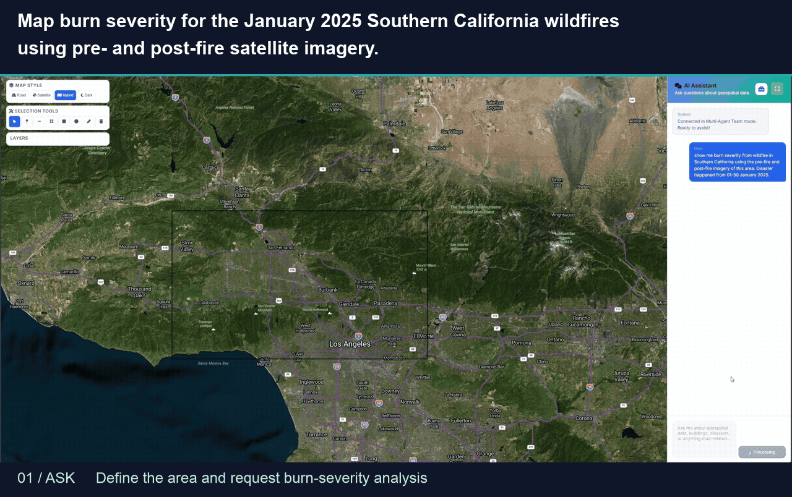
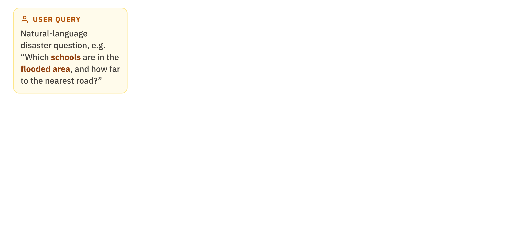
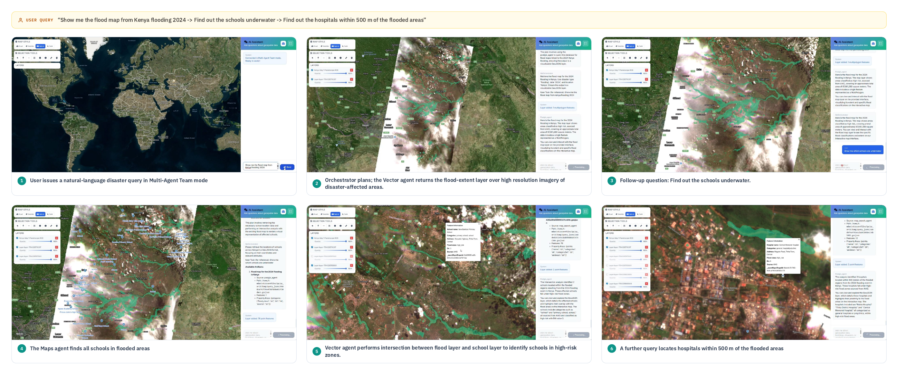

<h1 align="center">GeoFaham</h1>
  <p align="center">
    <strong>Multi-Agent Geospatial Analysis</strong>
  </p>



**[Quick start](#quick-start) · [Demos](docs/DEMO_GALLERY.md) · [Documentation](#documentation)**

## Overview

GeoFaham combines PostGIS records, OpenStreetMap features, satellite imagery, and
raster computation to answer geospatial questions about places, infrastructure,
and imagery. Its evaluation focuses on disaster-response tasks, including schools
within flood extents, building damage, and pre- and post-fire imagery.

## How it works

Four agents handle spatial queries, map features, imagery search, and raster
analysis. An Orchestrator maintains a task plan, tracks progress, and revises the
plan when execution stalls. The Response Store saves outputs as files; later
steps refer to response IDs and metadata rather than passing full geometries or
rasters through the model context.



[Static diagram](docs/figures/geofaham-system-overview.png) ·
[Agent reference](docs/AGENTS_DOCUMENTATION.md) ·
[Response Store](docs/RESPONSE_STORE.md)

## Quick start

### Requirements

- Python 3.11 or later.
- PostgreSQL and PostGIS; the supplied snapshot requires PostgreSQL 18.
- API access for your configured models.
- An Azure Maps subscription key for the web map.

### Install

```bash
git clone https://github.com/microsoft/GeoFaham.git
cd GeoFaham
python -m venv venv
source venv/bin/activate
pip install -r requirements.txt
cp .env.example .env
```

On Windows, activate the environment with `venv\Scripts\activate`.

### Configure

Edit `.env` with your credentials and database connection:

```dotenv
OPENAI_API_KEY=your_api_key
AZURE_MAPS_KEY=your_maps_key
GEOFAHAM_DEFAULT_MODEL_CLIENT='{"provider":"autogen_ext.models.openai.OpenAIChatCompletionClient","config":{"model":"gpt-4o","api_key":"$OPENAI_API_KEY"}}'
GEOFAHAM_REASONING_MODEL_CLIENT='{"provider":"autogen_ext.models.openai.OpenAIChatCompletionClient","config":{"model":"gpt-5.1","api_key":"$OPENAI_API_KEY","reasoning_effort":"medium"}}'
POSTGRES_HOST=localhost
POSTGRES_PORT=5432
POSTGRES_DB=geofaham
POSTGRES_USER=your_user
POSTGRES_PASSWORD=your_password
```

Azure OpenAI, custom endpoints, per-agent models, and path overrides are covered
in [configuration](docs/CONFIGURATION.md). The frontend loads `AZURE_MAPS_KEY`
from the server's `/api/config` endpoint.

### Load the disaster data

Place your copy of `geofaham_data_v1.sql.gz` in `data/backups/`, then follow
[database setup](data/backups/README.md) to verify and restore them:

```bash
python3 scripts/db_init.py --dry-run
python3 scripts/db_init.py
```

The loader creates the configured database and refuses an existing one. The
snapshot includes the schema and data. The Vector Agent and full team require a
populated database; Maps, STAC, and Raster can also run individually through
the [Python API](docs/API.md#python).

### Run

```bash
python server.py
```

Before accepting requests, startup checks validate model-client configuration,
PostGIS, required tables, metadata files, and writable runtime paths. See
[startup checks](docs/CONFIGURATION.md#startup-checks).

Open `http://localhost:8010`. For development:

```bash
uvicorn server:app --reload --host 127.0.0.1 --port 8010
```

## Demos

The [demo gallery](docs/DEMO_GALLERY.md) contains flood-and-schools, building
damage, imagery timeline, and burn-severity examples. Recordings are edited to
skip waiting and processing time.

[](docs/figures/geofaham-web-interface.png)

Click the figure for the full-size view. See [web interface](docs/UI_DOCUMENTATION.md)
for controls and rendering details.

## Documentation

| Topic | Reference |
|-------|-----------|
| Agents and orchestration | [Agent reference](docs/AGENTS_DOCUMENTATION.md) |
| Model clients and environment variables | [Configuration](docs/CONFIGURATION.md) |
| Database restore | [Database setup](data/backups/README.md) |
| Files and state | [Data directories](docs/DATA_DIRECTORY_STRUCTURE.md) |
| Artifact storage and SQL placeholders | [Response Store](docs/RESPONSE_STORE.md) |
| Raster code execution | [Raster Agent](docs/RASTER_CODE_GENERATION.md) |
| Response fields | [Tool response schemas](docs/TOOL_RESPONSE_SCHEMAS.md) |
| Python, HTTP, and tools | [API reference](docs/API.md) |
| Contributing and tests | [Development](docs/DEVELOPMENT.md) |

## License

[MIT License](LICENSE.txt)

## Trademarks

This project may contain trademarks or logos for projects, products, or services. Authorized use of Microsoft trademarks or logos is subject to and must follow [Microsoft's Trademark & Brand Guidelines](https://www.microsoft.com/en-us/legal/intellectualproperty/trademarks/usage/general). Use of Microsoft trademarks or logos in modified versions of this project must not cause confusion or imply Microsoft sponsorship. Any use of third-party trademarks or logos are subject to those third-party's policies.

## Acknowledgments

- [Microsoft Planetary Computer](https://planetarycomputer.microsoft.com/) for satellite data access
- [AutoGen](https://github.com/microsoft/autogen) for multi-agent framework
- [OpenStreetMap](https://www.openstreetmap.org/) contributors for map data
- [TiTiler](https://developmentseed.org/titiler/) for raster tile serving
