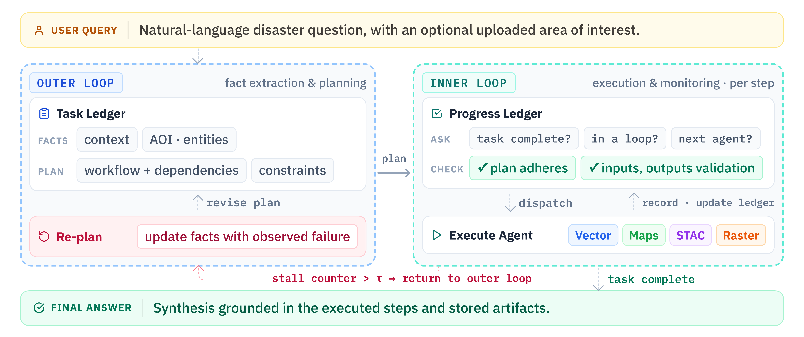

# Agents and orchestration

GeoFaham uses AutoGen `AssistantAgent` instances for four specialist roles and a
custom `GeoFahamGroupChat` to coordinate them. Team creation is in
[team.py](../agents/team.py).

| Role | Agent name | Factory |
|------|------------|---------|
| Vector | `postgis_agent` | `create_vector_agent()` |
| Maps | `osm_map_agent` | `create_map_search_agent()` |
| STAC | `stac_agent` | `create_stac_agent()` |
| Raster | `raster_ops_agent` | `create_raster_ops_agent()` |

## Orchestrator Agent

The Orchestrator extracts task facts and creates a plan. If it identifies missing
information or conflicting constraints that require a user answer, it pauses
before planning or tool dispatch and reassesses the reply before continuing.
It then selects an agent, evaluates progress, and either continues, revises the
plan, requests user
input, or produces a final answer. Repeated stalls return control to planning.
Tool responses are parsed into the shared response model and registered for
later steps.

Planning and progress tracking use separate model clients. Facts and progress
responses are validated against Pydantic schemas. Before dispatch and completion,
code checks response IDs, artifact files, declared formats, and metadata.
Failed checks return a reason for correction; exhausted retries produce an
incomplete-work report. The model assesses whether the inputs and operations
answer the user's question.

Single-date imagery requests use `single_scene`. The raster loader rejects multiple
acquisition dates in that mode and records scene IDs and dates. The Orchestrator
checks that provenance before reusing or accepting the raster output.

| Source | Responsibility |
|--------|----------------|
| [group_chat.py](../agents/orchestrator_agent/group_chat.py) | Team wrapper and configuration |
| [orchestrator.py](../agents/orchestrator_agent/orchestrator.py) | Planning, dispatch, state, and progress handling |
| [_prompts.py](../agents/orchestrator_agent/_prompts.py) | Facts, plan, and final-answer prompts |
| [_prompt_progress.py](../agents/orchestrator_agent/_prompt_progress.py) | Progress prompt and ledger schema |
| [_agent_capabilities.py](../agents/orchestrator_agent/_agent_capabilities.py) | Agent descriptions supplied to the planner |

## Vector Agent (PostGIS)

The [Vector Agent](../agents/vector_agent/assistant.py) creates a
`VectorQueryExecutor`, loads the database schema and disaster catalog, and
injects them into its prompt. This requires an available, populated database at
agent creation, including when creating the full team.

| Tool | Operation |
|------|-----------|
| `execute_query` | SELECT query with layer or tabular output |
| `execute_query_with_geojson` | SELECT query that incorporates artifacts identified by response IDs |
| `create_buffer` | Buffer stored vector artifacts, with unit conversion |
| `get_available_responses` | Discover prior tool outputs |

`execute_query_with_geojson()` resolves response IDs and expands GeoJSON
placeholders into geometry-specific SQL CTEs. See
[SQL placeholders](RESPONSE_STORE.md#sql-placeholders) for syntax. The executor checks
query text before execution; database permissions also determine what the
connection can do.

The supplied schema includes `disasters`, `building_damage_assessment`, and
`flood_maps`. A schema cache describes these tables; it does not supply their
records. See [database setup](../data/backups/README.md).

## Maps Agent (OSM)

The [Maps Agent](../agents/maps_agent/assistant.py) retrieves features through
OSMnx and configured Nominatim/Overpass services.

| Tool group | Tools |
|------------|-------|
| Features | `get_roads`, `get_buildings`, `get_waterways`, `get_bridges`, `get_pois` |
| Areas and categories | `get_admin_boundary`, `get_neighborhoods`, `get_landuse`, `get_natural_features`, `get_infrastructure` |
| Search | `get_features_by_tags`, `search_feature_by_name` |
| Locations | `get_address_coordinates`, `get_place_bounding_box`, `reverse_geocode` |
| Prior results | `get_available_responses` |

Feature tools accept the location forms defined in their signatures, including
place names, bounds, or GeoJSON areas where supported. Results depend on OSM
coverage and the selected tags; a missing feature does not establish that it
does not exist on the ground.

## STAC Agent

The [STAC Agent](../agents/stac_agent/assistant.py) exposes
`get_collection_details`, `execute_stac_search`, and `get_available_responses`.
It searches Microsoft Planetary Computer collections and can return imagery
references for analysis or map-ready visualization outputs.

`execute_stac_search()` takes grouped collection choices, an AOI GeoJSON path,
an item limit, a mode, and a minimum coverage percentage. Collection groups can
include query filters, pre/post date ranges, and visualization band settings.

| Mode | Use |
|------|-----|
| `fetch` | Persist item metadata for downstream analysis, including dual-date inputs |
| `show` | Prepare imagery display and temporal visualization |

Coverage measures how much of the AOI the returned scenes cover. Cloud masking,
band selection, dates, and alignment are handled during raster analysis.

## Raster Ops Agent

The [Raster Agent](../agents/raster_ops_agent/assistant.py) exposes
`execute_custom_raster_code` and `get_available_responses`. It generates code
using registered imagery and other artifacts, then returns raster layers,
vector layers, intermediate outputs, or statistics.

See [raster code execution](RASTER_CODE_GENERATION.md) for arguments, helpers,
result handling, and process limits.

## Example: schools within a flood extent

For “Which schools intersect the mapped extent of the 2024 Kenya floods?”:

1. Vector retrieves the flood extent for the specified event.
2. Maps retrieves school features for that area.
3. Vector intersects the school features with the flood geometry.
4. The Orchestrator reports the count and references the result layer.

Each step passes response IDs for stored artifacts. The final intersection uses
the flood extent; an administrative boundary can scope retrieval. The result
identifies overlap with the flood map, which may indicate exposure. Observed
damage and current operating status require additional data. See the
[recorded example](DEMO_GALLERY.md#kenya-flood-analysis).

## Core modules

| Module | Responsibility |
|--------|----------------|
| [config.py](../agents/core/config.py) | Environment settings, paths, and model-client profiles |
| [types.py](../agents/core/types.py) | Response, artifact, and state models |
| [constants.py](../agents/core/constants.py) | Agent names and processing limits |
| [response_store.py](../agents/core/response_store.py) | Response registry and persistence |
| [logging.py](../agents/core/logging.py) | Logger configuration |
| [exceptions.py](../agents/core/exceptions.py) | Domain exceptions |

Use [configuration](CONFIGURATION.md) for model settings,
[response schemas](TOOL_RESPONSE_SCHEMAS.md) for payload fields, and
[API reference](API.md) for Python and HTTP entry points.
