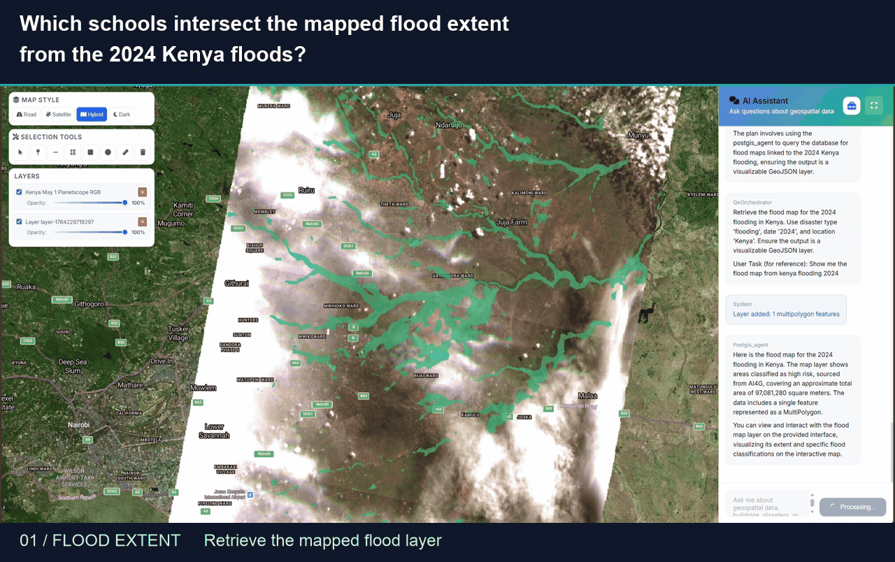
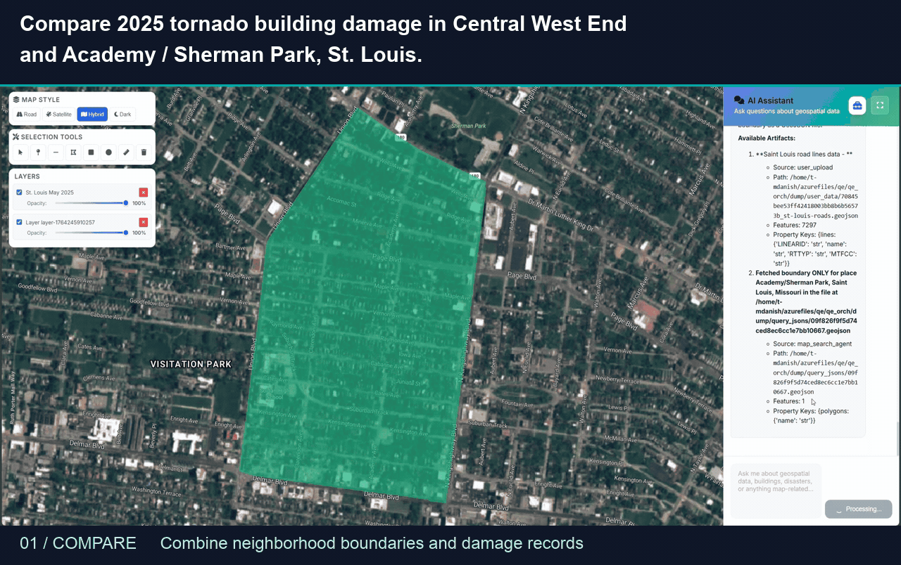
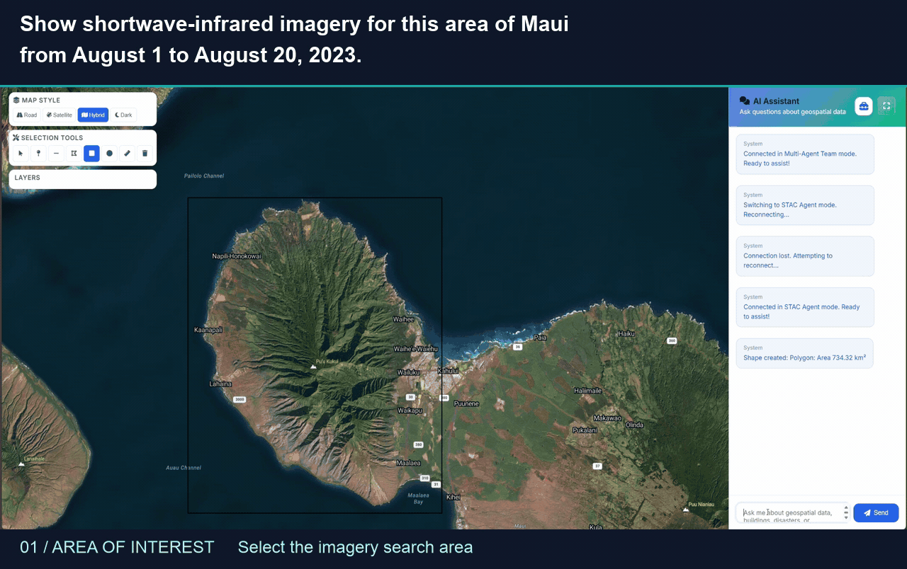

# Demo gallery

Four edited recordings show raster, vector, and imagery workflows. Requests
are shortened from the recorded prompts. Captions identify the steps; cuts skip
waiting and processing time, so GIF duration is not execution time.

## Burn-severity raster

> Map burn severity for the January 2025 Southern California wildfires using pre- and post-fire satellite imagery.

GeoFaham generates a burn-severity raster from pre- and post-fire imagery. The
recording shows the selected AOI, colored output, burn-scar inspection, and legend.

Watch the burn-severity workflow (12 seconds)

## Kenya flood analysis

> Which schools intersect the mapped flood extent from the 2024 Kenya floods?

The workflow retrieves the flood layer, finds school locations, and intersects
the layers to identify potentially affected schools. The map progresses from
flood extent to school locations and the resulting intersection layer.

Watch the flood-and-schools workflow (12 seconds)

## St. Louis building damage

> Compare 2025 tornado building damage in Central West End and Academy / Sherman Park, St. Louis.

GeoFaham combines neighborhood boundaries with existing building-damage
assessments. The map shows building-level damage and a shared legend alongside
the conversational comparison.

Watch the neighborhood damage comparison (10 seconds)

## Satellite imagery timeline

> Show shortwave-infrared imagery for this area of Maui from August 1 to August 20, 2023.

GeoFaham retrieves shortwave-infrared imagery for the selected AOI. The timeline
control switches between available acquisition dates.

Watch the imagery-and-timeline workflow (12 seconds)

See the [web interface documentation](UI_DOCUMENTATION.md) for map controls,
or return to the [project README](../README.md).
