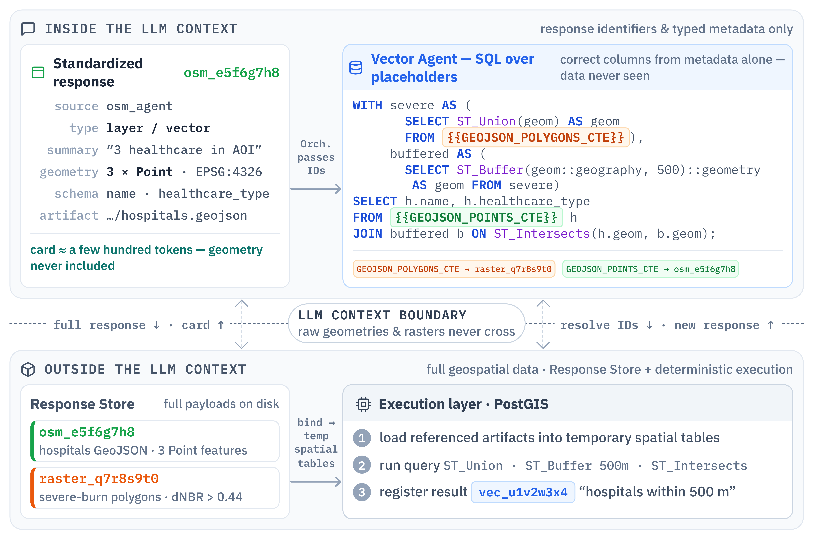

# Response Store



`ResponseStore` in [response_store.py](../agents/core/response_store.py) maintains
an in-memory index of tool responses and appends entries to a JSONL file.
The default path is `runtime/state/response_store.jsonl`.

## Stored entries

Each entry contains a `GeoFahamToolResponse`, a timestamp, and an optional plan
step number. The response includes its ID, source, summary, data, artifact
reference, and metadata. The artifact payload remains in its GeoJSON, raster, or
imagery file; the store records its path.

Entries are indexed by `response_id`. A later entry with the same ID replaces
the in-memory value. Existing entries are loaded when the store starts.

## Access

```python
from agents.core.response_store import get_response_store

store = get_response_store()
response = store.get(response_id)
path = response.artifact.path if response.artifact else None
```

`get()` raises `ResponseNotFoundError` for an unknown ID. `get_or_none()` returns
`None` instead. `get_all()` returns stored responses in insertion order.

The agent tool `get_available_responses(filter_errors=True)` returns a JSON
object with `message` and `responses`. Errors are excluded by default. The
returned responses include metadata and structured data, not just identifiers.

## Workflow

1. A tool creates an output file and returns its response.
2. The Orchestrator registers every parsed tool response in the agent turn, including
   intermediate results and failures, with the current step number.
3. A later instruction refers to the response ID.
4. The consuming tool resolves the artifact and operates on its full contents.

State serialization can include the response index so a restored team can reuse
previous outputs. Files referenced by that state must still exist.

Artifact checks compare declared feature counts, geometry types, raster CRS,
and band counts with the saved files. The Orchestrator uses these checks and
the supplied metadata to assess inputs for later steps.

## Storage limits

The registry does not copy or embed artifact files. Moving or deleting a file
can leave its entry unusable. Metadata fields depend on the producing tool.

Persistence errors are logged by the current implementation. The store does not
provide database transactions or cross-process file locking. Use separate
runtime paths for independent runs that must not share state.

## SQL placeholders

`VectorQueryExecutor.execute_query_with_geojson()` takes SQL and `response_ids`.
It reads the referenced GeoJSON files and expands placeholders into SQL common
table expressions (CTEs).

| Placeholder | Generated CTE |
|-------------|---------------|
| `{{GEOJSON_POINTS_CTE}}` | `points_from_geojson` |
| `{{GEOJSON_LINES_CTE}}` | `lines_from_geojson` |
| `{{GEOJSON_POLYGONS_CTE}}` | `polygons_from_geojson` |
| `{{GEOJSON_GEOMTYPE_CTES}}` | All applicable geometry CTEs |

For school points and flood polygons, pass both response IDs with:

```sql
WITH {{GEOJSON_POINTS_CTE}}, {{GEOJSON_POLYGONS_CTE}}
SELECT schools.*
FROM points_from_geojson AS schools
WHERE EXISTS (
    SELECT 1
    FROM polygons_from_geojson AS flood
    WHERE ST_Intersects(schools.geom, flood.geom)
)
```

`EXISTS` avoids duplicating a school that intersects several flood polygons.
Property names must match the artifact schema. Inputs are expanded into the
query rather than stored in persistent database tables, so large files increase
SQL construction and execution costs. See
[tools.py](../agents/vector_agent/tools.py) for implementation.

See [data directories](DATA_DIRECTORY_STRUCTURE.md) for paths and cleanup, and
[tool responses](TOOL_RESPONSE_SCHEMAS.md) for payload fields.
